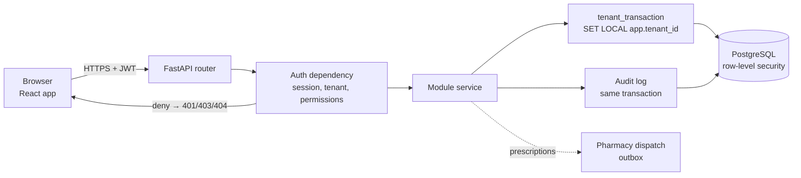
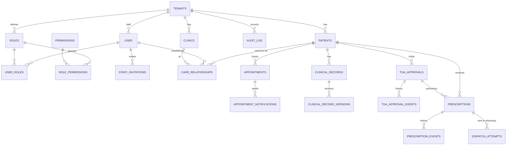

# ClinicOS

[](../../actions/workflows/test-backend.yml)
[](../../actions/workflows/test-docker-compose.yml)

A multi-tenant clinical prescribing platform for Australian clinics: patients, appointments, consult
notes, TGA approvals, prescriptions and pharmacy dispatch, with every change audited.

**Stack:** FastAPI + SQLModel + PostgreSQL (Neon) · React + TanStack + Tailwind · FastAPI Cloud.

> **Status: MVP.** `docs/` describes the target design; the code in `backend/app/` is what exists.

## Quick start

```bash
cp .env.example .env                  # then replace every REPLACE_ME
docker compose up -d db mailpit       # local Postgres + mail catcher

cd backend
uv sync
uv run bash scripts/prestart.sh       # migrations + first superuser
uv run fastapi dev app/main.py        # API on :8000

cd .. && bun install && bun run dev   # app on :5174
```

Tests: `cd backend && uv run pytest` · `bun run test` (Playwright). Full guide: [HOW_TO_RUN.md](HOW_TO_RUN.md).

## File structure

```
clinic-os/
├── backend/
│   ├── app/
│   │   ├── main.py            # FastAPI app, middleware, serves the built frontend
│   │   ├── core/              # config, db + tenant transactions, security, logging, timing
│   │   ├── modules/           # one folder per domain: models · schemas · service · router
│   │   │   ├── identity_tenancy/   users_roles/    clinics/
│   │   │   ├── patients/           care_relationships/  clinical_records/
│   │   │   ├── appointments/       tga_approvals/  prescriptions/
│   │   │   └── dashboard/          audit/
│   │   ├── api/               # legacy template routes (frozen) + shared dependencies
│   │   ├── db_models.py       # registers every table for Alembic
│   │   └── alembic/           # migrations
│   └── tests/
├── frontend/src/
│   ├── routes/                # TanStack Router pages
│   ├── features/              # screens per domain
│   ├── data/                  # TanStack Query hooks
│   └── client/                # generated API SDK
├── docs/                      # features, tasks, reference (build contract, schema, performance)
└── scripts/                   # client generation, schema diagram, production timing
```

## Data flow



1. The browser sends a request with a bearer token.
2. The auth dependency verifies the session and **resolves the tenant from the account** — never from
   the request.
3. The module service checks permissions, then runs inside `tenant_transaction`, so Postgres
   row-level security only shows that tenant's rows.
4. The audit event is written in the same transaction; if it fails, the change fails.

## Data model

Every clinical table carries `tenant_id` (omitted below for brevity). Full generated schema:
[docs/reference/schema](docs/reference/schema/README.md).



## Rules that always hold

- **Deny by default.** The backend is the only security boundary; the frontend only hides and warns.
- **Tenant is resolved, never supplied.** A `tenant_id` from the client is ignored.
- **`404`, not `403`,** across tenants.
- **No patient data** in logs, metrics or error responses.
- **Audit in the same transaction** as the change.

Full list: [AGENTS.md](AGENTS.md) and [docs/reference/build-contract.md](docs/reference/build-contract.md).

## More docs

[docs/README.md](docs/README.md) · [development.md](development.md) · [deployment.md](deployment.md) ·
[performance](docs/reference/performance.md) · [release-notes.md](release-notes.md)

## License

MIT.
