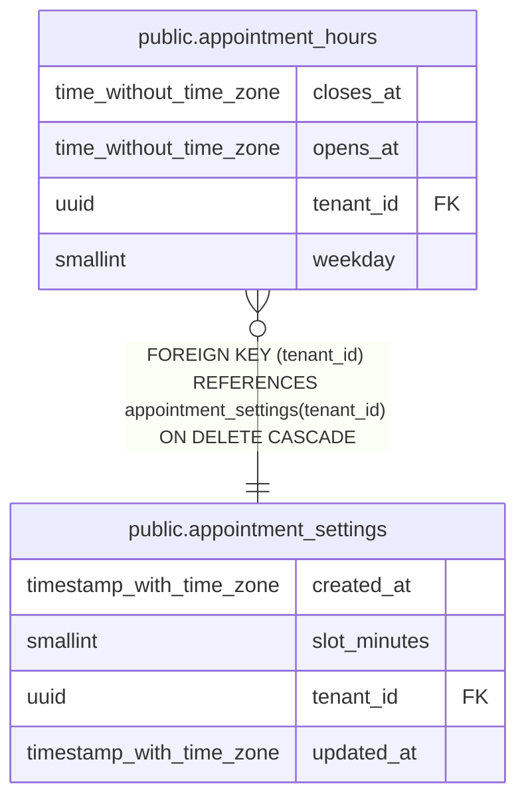

# public.appointment_hours

## Columns

| Name | Type | Default | Nullable | Children | Parents | Comment |
| ---- | ---- | ------- | -------- | -------- | ------- | ------- |
| closes_at | time without time zone |  | true |  |  |  |
| opens_at | time without time zone |  | true |  |  |  |
| tenant_id | uuid |  | false |  | [public.appointment_settings](public.appointment_settings.md) |  |
| weekday | smallint |  | false |  |  |  |

## Constraints

| Name | Type | Definition |
| ---- | ---- | ---------- |
| appointment_hours_tenant_id_not_null | n | NOT NULL tenant_id |
| appointment_hours_weekday_not_null | n | NOT NULL weekday |
| ck_appointment_hours_on_the_mark | CHECK | CHECK (((opens_at IS NULL) OR ((((EXTRACT(minute FROM opens_at))::integer % 5) = 0) AND (EXTRACT(second FROM opens_at) = (0)::numeric) AND (((EXTRACT(minute FROM closes_at))::integer % 5) = 0) AND (EXTRACT(second FROM closes_at) = (0)::numeric)))) |
| ck_appointment_hours_open_or_closed | CHECK | CHECK (((opens_at IS NULL) = (closes_at IS NULL))) |
| ck_appointment_hours_opens_before_closes | CHECK | CHECK (((opens_at IS NULL) OR (closes_at > opens_at))) |
| ck_appointment_hours_weekday | CHECK | CHECK (((weekday >= 1) AND (weekday <= 7))) |
| fk_appointment_hours_tenant_settings | FOREIGN KEY | FOREIGN KEY (tenant_id) REFERENCES appointment_settings(tenant_id) ON DELETE CASCADE |
| pk_appointment_hours | PRIMARY KEY | PRIMARY KEY (tenant_id, weekday) |

## Indexes

| Name | Definition |
| ---- | ---------- |
| pk_appointment_hours | CREATE UNIQUE INDEX pk_appointment_hours ON public.appointment_hours USING btree (tenant_id, weekday) |

## Relations

---

> Generated by [tbls](https://github.com/k1LoW/tbls)
