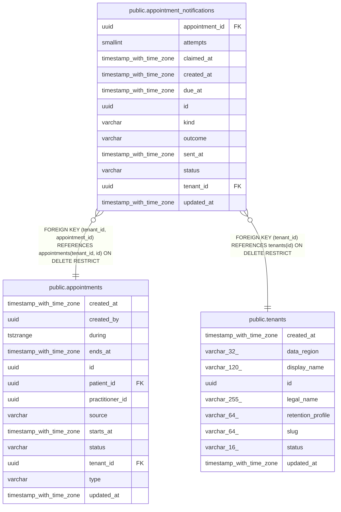

# public.appointment_notifications

## Columns

| Name | Type | Default | Nullable | Children | Parents | Comment |
| ---- | ---- | ------- | -------- | -------- | ------- | ------- |
| appointment_id | uuid |  | false |  | [public.appointments](public.appointments.md) |  |
| attempts | smallint |  | false |  |  |  |
| claimed_at | timestamp with time zone |  | true |  |  |  |
| created_at | timestamp with time zone |  | false |  |  |  |
| due_at | timestamp with time zone |  | false |  |  |  |
| id | uuid | gen_random_uuid() | false |  |  |  |
| kind | varchar |  | false |  |  |  |
| outcome | varchar |  | true |  |  |  |
| sent_at | timestamp with time zone |  | true |  |  |  |
| status | varchar |  | false |  |  |  |
| tenant_id | uuid |  | false |  | [public.tenants](public.tenants.md) [public.appointments](public.appointments.md) |  |
| updated_at | timestamp with time zone |  | false |  |  |  |

## Constraints

| Name | Type | Definition |
| ---- | ---- | ---------- |
| appointment_notifications_appointment_id_not_null | n | NOT NULL appointment_id |
| appointment_notifications_attempts_not_null | n | NOT NULL attempts |
| appointment_notifications_created_at_not_null | n | NOT NULL created_at |
| appointment_notifications_due_at_not_null | n | NOT NULL due_at |
| appointment_notifications_id_not_null | n | NOT NULL id |
| appointment_notifications_kind_not_null | n | NOT NULL kind |
| appointment_notifications_status_not_null | n | NOT NULL status |
| appointment_notifications_tenant_id_not_null | n | NOT NULL tenant_id |
| appointment_notifications_updated_at_not_null | n | NOT NULL updated_at |
| ck_appointment_notifications_attempts | CHECK | CHECK ((attempts >= 0)) |
| ck_appointment_notifications_kind | CHECK | CHECK (((kind)::text = ANY ((ARRAY['CONFIRMATION'::character varying, 'REMINDER'::character varying])::text[]))) |
| ck_appointment_notifications_outcome | CHECK | CHECK (((outcome IS NULL) OR ((outcome)::text = ANY ((ARRAY['BOOKING_NOT_LIVE'::character varying, 'STARTED'::character varying, 'NO_EMAIL'::character varying, 'SMTP_ERROR'::character varying, 'OPTED_OUT'::character varying])::text[])))) |
| ck_appointment_notifications_sent_at | CHECK | CHECK ((((status)::text = 'SENT'::text) = (sent_at IS NOT NULL))) |
| ck_appointment_notifications_status | CHECK | CHECK (((status)::text = ANY ((ARRAY['PENDING'::character varying, 'SENDING'::character varying, 'SENT'::character varying, 'SKIPPED'::character varying, 'FAILED'::character varying])::text[]))) |
| fk_appointment_notifications_tenant_appointment | FOREIGN KEY | FOREIGN KEY (tenant_id, appointment_id) REFERENCES appointments(tenant_id, id) ON DELETE RESTRICT |
| fk_appointment_notifications_tenant_id_tenants | FOREIGN KEY | FOREIGN KEY (tenant_id) REFERENCES tenants(id) ON DELETE RESTRICT |
| pk_appointment_notifications | PRIMARY KEY | PRIMARY KEY (id) |
| uq_appointment_notifications_one_per_kind | UNIQUE | UNIQUE (tenant_id, appointment_id, kind) |

## Indexes

| Name | Definition |
| ---- | ---------- |
| ix_appointment_notifications_tenant_status_due | CREATE INDEX ix_appointment_notifications_tenant_status_due ON public.appointment_notifications USING btree (tenant_id, status, due_at) |
| pk_appointment_notifications | CREATE UNIQUE INDEX pk_appointment_notifications ON public.appointment_notifications USING btree (id) |
| uq_appointment_notifications_one_per_kind | CREATE UNIQUE INDEX uq_appointment_notifications_one_per_kind ON public.appointment_notifications USING btree (tenant_id, appointment_id, kind) |

## Relations

---

> Generated by [tbls](https://github.com/k1LoW/tbls)
