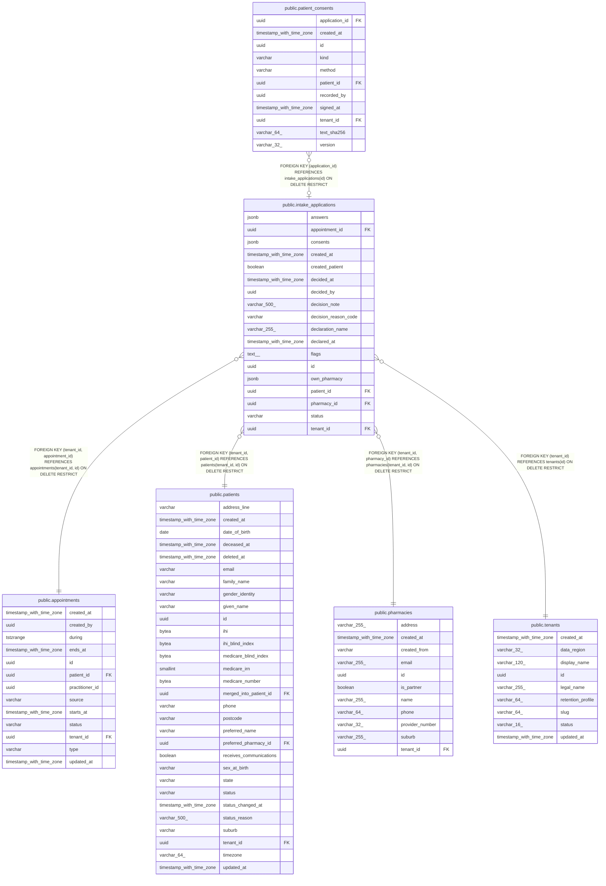

# public.intake_applications

## Columns

| Name | Type | Default | Nullable | Children | Parents | Comment |
| ---- | ---- | ------- | -------- | -------- | ------- | ------- |
| answers | jsonb |  | false |  |  |  |
| appointment_id | uuid |  | true |  | [public.appointments](public.appointments.md) |  |
| consents | jsonb |  | false |  |  |  |
| created_at | timestamp with time zone |  | false |  |  |  |
| created_patient | boolean |  | false |  |  |  |
| decided_at | timestamp with time zone |  | true |  |  |  |
| decided_by | uuid |  | true |  |  |  |
| decision_note | varchar(500) |  | true |  |  |  |
| decision_reason_code | varchar |  | true |  |  |  |
| declaration_name | varchar(255) |  | false |  |  |  |
| declared_at | timestamp with time zone |  | false |  |  |  |
| flags | text[] | '{}'::text[] | false |  |  |  |
| id | uuid | gen_random_uuid() | false | [public.patient_consents](public.patient_consents.md) |  |  |
| own_pharmacy | jsonb |  | true |  |  |  |
| patient_id | uuid |  | false |  | [public.patients](public.patients.md) |  |
| pharmacy_id | uuid |  | true |  | [public.pharmacies](public.pharmacies.md) |  |
| status | varchar |  | false |  |  |  |
| tenant_id | uuid |  | false |  | [public.tenants](public.tenants.md) [public.patients](public.patients.md) [public.appointments](public.appointments.md) [public.pharmacies](public.pharmacies.md) |  |

## Constraints

| Name | Type | Definition |
| ---- | ---- | ---------- |
| ck_intake_applications_decision_reason_code | CHECK | CHECK (((decision_reason_code IS NULL) OR ((decision_reason_code)::text = ANY ((ARRAY['NOT_ELIGIBLE'::character varying, 'NEEDS_IN_PERSON_REVIEW'::character varying, 'DUPLICATE'::character varying, 'INCOMPLETE'::character varying, 'OTHER'::character varying])::text[])))) |
| ck_intake_applications_status | CHECK | CHECK (((status)::text = ANY ((ARRAY['SUBMITTED'::character varying, 'ACCEPTED'::character varying, 'REJECTED'::character varying])::text[]))) |
| fk_intake_applications_tenant_appointment | FOREIGN KEY | FOREIGN KEY (tenant_id, appointment_id) REFERENCES appointments(tenant_id, id) ON DELETE RESTRICT |
| fk_intake_applications_tenant_id_tenants | FOREIGN KEY | FOREIGN KEY (tenant_id) REFERENCES tenants(id) ON DELETE RESTRICT |
| fk_intake_applications_tenant_patient | FOREIGN KEY | FOREIGN KEY (tenant_id, patient_id) REFERENCES patients(tenant_id, id) ON DELETE RESTRICT |
| fk_intake_applications_tenant_pharmacy | FOREIGN KEY | FOREIGN KEY (tenant_id, pharmacy_id) REFERENCES pharmacies(tenant_id, id) ON DELETE RESTRICT |
| intake_applications_answers_not_null | n | NOT NULL answers |
| intake_applications_consents_not_null | n | NOT NULL consents |
| intake_applications_created_at_not_null | n | NOT NULL created_at |
| intake_applications_created_patient_not_null | n | NOT NULL created_patient |
| intake_applications_declaration_name_not_null | n | NOT NULL declaration_name |
| intake_applications_declared_at_not_null | n | NOT NULL declared_at |
| intake_applications_flags_not_null | n | NOT NULL flags |
| intake_applications_id_not_null | n | NOT NULL id |
| intake_applications_patient_id_not_null | n | NOT NULL patient_id |
| intake_applications_status_not_null | n | NOT NULL status |
| intake_applications_tenant_id_not_null | n | NOT NULL tenant_id |
| pk_intake_applications | PRIMARY KEY | PRIMARY KEY (id) |

## Indexes

| Name | Definition |
| ---- | ---------- |
| ix_intake_applications_tenant_patient | CREATE INDEX ix_intake_applications_tenant_patient ON public.intake_applications USING btree (tenant_id, patient_id) |
| ix_intake_applications_tenant_status_created | CREATE INDEX ix_intake_applications_tenant_status_created ON public.intake_applications USING btree (tenant_id, status, created_at) |
| pk_intake_applications | CREATE UNIQUE INDEX pk_intake_applications ON public.intake_applications USING btree (id) |

## Relations

---

> Generated by [tbls](https://github.com/k1LoW/tbls)
