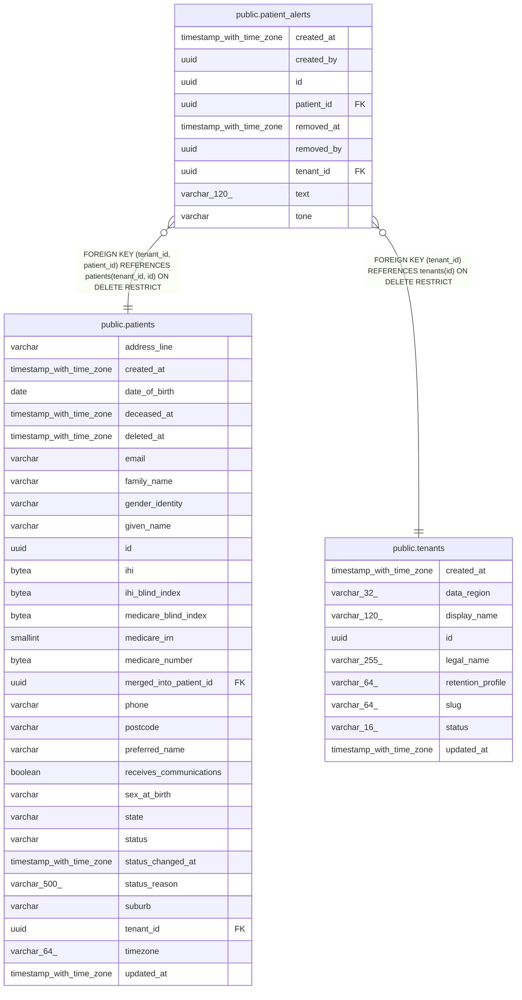

# public.patient_alerts

## Columns

| Name | Type | Default | Nullable | Children | Parents | Comment |
| ---- | ---- | ------- | -------- | -------- | ------- | ------- |
| created_at | timestamp with time zone |  | false |  |  |  |
| created_by | uuid |  | false |  |  |  |
| id | uuid | gen_random_uuid() | false |  |  |  |
| patient_id | uuid |  | false |  | [public.patients](public.patients.md) |  |
| removed_at | timestamp with time zone |  | true |  |  |  |
| removed_by | uuid |  | true |  |  |  |
| tenant_id | uuid |  | false |  | [public.tenants](public.tenants.md) [public.patients](public.patients.md) |  |
| text | varchar(120) |  | false |  |  |  |
| tone | varchar |  | false |  |  |  |

## Constraints

| Name | Type | Definition |
| ---- | ---- | ---------- |
| ck_patient_alerts_tone | CHECK | CHECK (((tone)::text = ANY ((ARRAY['INFO'::character varying, 'WARN'::character varying, 'DANGER'::character varying])::text[]))) |
| fk_patient_alerts_tenant_id_tenants | FOREIGN KEY | FOREIGN KEY (tenant_id) REFERENCES tenants(id) ON DELETE RESTRICT |
| fk_patient_alerts_tenant_patient | FOREIGN KEY | FOREIGN KEY (tenant_id, patient_id) REFERENCES patients(tenant_id, id) ON DELETE RESTRICT |
| patient_alerts_created_at_not_null | n | NOT NULL created_at |
| patient_alerts_created_by_not_null | n | NOT NULL created_by |
| patient_alerts_id_not_null | n | NOT NULL id |
| patient_alerts_patient_id_not_null | n | NOT NULL patient_id |
| patient_alerts_tenant_id_not_null | n | NOT NULL tenant_id |
| patient_alerts_text_not_null | n | NOT NULL text |
| patient_alerts_tone_not_null | n | NOT NULL tone |
| pk_patient_alerts | PRIMARY KEY | PRIMARY KEY (id) |

## Indexes

| Name | Definition |
| ---- | ---------- |
| ix_patient_alerts_tenant_patient | CREATE INDEX ix_patient_alerts_tenant_patient ON public.patient_alerts USING btree (tenant_id, patient_id) |
| pk_patient_alerts | CREATE UNIQUE INDEX pk_patient_alerts ON public.patient_alerts USING btree (id) |

## Relations

---

> Generated by [tbls](https://github.com/k1LoW/tbls)
