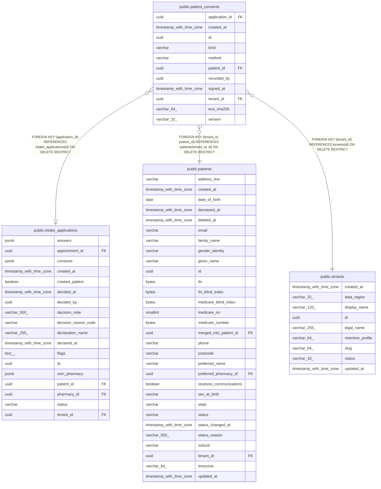

# public.patient_consents

## Columns

| Name | Type | Default | Nullable | Children | Parents | Comment |
| ---- | ---- | ------- | -------- | -------- | ------- | ------- |
| application_id | uuid |  | true |  | [public.intake_applications](public.intake_applications.md) |  |
| created_at | timestamp with time zone |  | false |  |  |  |
| id | uuid | gen_random_uuid() | false |  |  |  |
| kind | varchar |  | false |  |  |  |
| method | varchar |  | false |  |  |  |
| patient_id | uuid |  | false |  | [public.patients](public.patients.md) |  |
| recorded_by | uuid |  | true |  |  |  |
| signed_at | timestamp with time zone |  | false |  |  |  |
| tenant_id | uuid |  | false |  | [public.tenants](public.tenants.md) [public.patients](public.patients.md) |  |
| text_sha256 | varchar(64) |  | false |  |  |  |
| version | varchar(32) |  | false |  |  |  |

## Constraints

| Name | Type | Definition |
| ---- | ---- | ---------- |
| ck_patient_consents_kind | CHECK | CHECK (((kind)::text = ANY ((ARRAY['PRIVACY'::character varying, 'TELEHEALTH'::character varying, 'TREATMENT'::character varying])::text[]))) |
| ck_patient_consents_method | CHECK | CHECK (((method)::text = ANY ((ARRAY['ONLINE_APPLICATION'::character varying, 'IN_CLINIC'::character varying])::text[]))) |
| fk_patient_consents_application_id_intake_applications | FOREIGN KEY | FOREIGN KEY (application_id) REFERENCES intake_applications(id) ON DELETE RESTRICT |
| fk_patient_consents_tenant_id_tenants | FOREIGN KEY | FOREIGN KEY (tenant_id) REFERENCES tenants(id) ON DELETE RESTRICT |
| fk_patient_consents_tenant_patient | FOREIGN KEY | FOREIGN KEY (tenant_id, patient_id) REFERENCES patients(tenant_id, id) ON DELETE RESTRICT |
| patient_consents_created_at_not_null | n | NOT NULL created_at |
| patient_consents_id_not_null | n | NOT NULL id |
| patient_consents_kind_not_null | n | NOT NULL kind |
| patient_consents_method_not_null | n | NOT NULL method |
| patient_consents_patient_id_not_null | n | NOT NULL patient_id |
| patient_consents_signed_at_not_null | n | NOT NULL signed_at |
| patient_consents_tenant_id_not_null | n | NOT NULL tenant_id |
| patient_consents_text_sha256_not_null | n | NOT NULL text_sha256 |
| patient_consents_version_not_null | n | NOT NULL version |
| pk_patient_consents | PRIMARY KEY | PRIMARY KEY (id) |

## Indexes

| Name | Definition |
| ---- | ---------- |
| ix_patient_consents_tenant_patient | CREATE INDEX ix_patient_consents_tenant_patient ON public.patient_consents USING btree (tenant_id, patient_id) |
| pk_patient_consents | CREATE UNIQUE INDEX pk_patient_consents ON public.patient_consents USING btree (id) |

## Relations

---

> Generated by [tbls](https://github.com/k1LoW/tbls)
