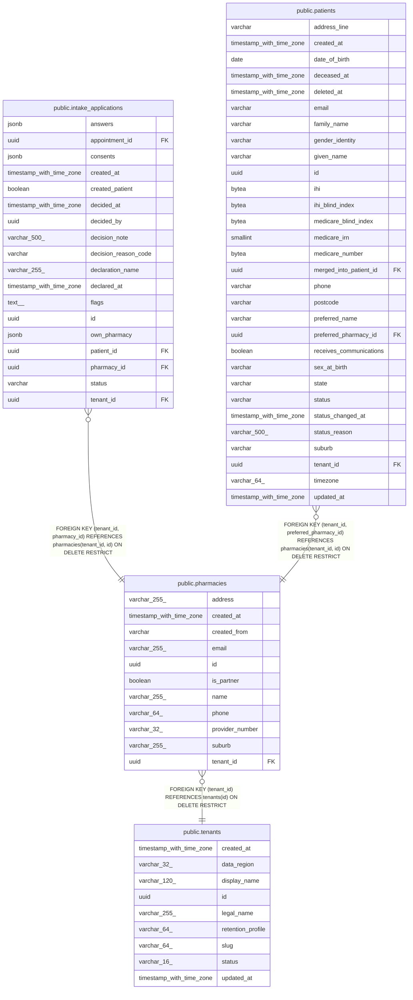

# public.pharmacies

## Columns

| Name | Type | Default | Nullable | Children | Parents | Comment |
| ---- | ---- | ------- | -------- | -------- | ------- | ------- |
| address | varchar(255) |  | true |  |  |  |
| created_at | timestamp with time zone |  | false |  |  |  |
| created_from | varchar |  | false |  |  |  |
| email | varchar(255) |  | true |  |  |  |
| id | uuid | gen_random_uuid() | false | [public.intake_applications](public.intake_applications.md) [public.patients](public.patients.md) |  |  |
| is_partner | boolean | false | false |  |  |  |
| name | varchar(255) |  | false |  |  |  |
| phone | varchar(64) |  | true |  |  |  |
| provider_number | varchar(32) |  | true |  |  |  |
| suburb | varchar(255) |  | false |  |  |  |
| tenant_id | uuid |  | false | [public.intake_applications](public.intake_applications.md) [public.patients](public.patients.md) | [public.tenants](public.tenants.md) |  |

## Constraints

| Name | Type | Definition |
| ---- | ---- | ---------- |
| ck_pharmacies_created_from | CHECK | CHECK (((created_from)::text = ANY ((ARRAY['STAFF'::character varying, 'APPLICATION'::character varying])::text[]))) |
| fk_pharmacies_tenant_id_tenants | FOREIGN KEY | FOREIGN KEY (tenant_id) REFERENCES tenants(id) ON DELETE RESTRICT |
| pharmacies_created_at_not_null | n | NOT NULL created_at |
| pharmacies_created_from_not_null | n | NOT NULL created_from |
| pharmacies_id_not_null | n | NOT NULL id |
| pharmacies_is_partner_not_null | n | NOT NULL is_partner |
| pharmacies_name_not_null | n | NOT NULL name |
| pharmacies_suburb_not_null | n | NOT NULL suburb |
| pharmacies_tenant_id_not_null | n | NOT NULL tenant_id |
| pk_pharmacies | PRIMARY KEY | PRIMARY KEY (id) |
| uq_pharmacies_tenant_id_id | UNIQUE | UNIQUE (tenant_id, id) |

## Indexes

| Name | Definition |
| ---- | ---------- |
| ix_pharmacies_tenant_name | CREATE INDEX ix_pharmacies_tenant_name ON public.pharmacies USING btree (tenant_id, name) |
| pk_pharmacies | CREATE UNIQUE INDEX pk_pharmacies ON public.pharmacies USING btree (id) |
| uq_pharmacies_tenant_id_id | CREATE UNIQUE INDEX uq_pharmacies_tenant_id_id ON public.pharmacies USING btree (tenant_id, id) |

## Relations

---

> Generated by [tbls](https://github.com/k1LoW/tbls)
