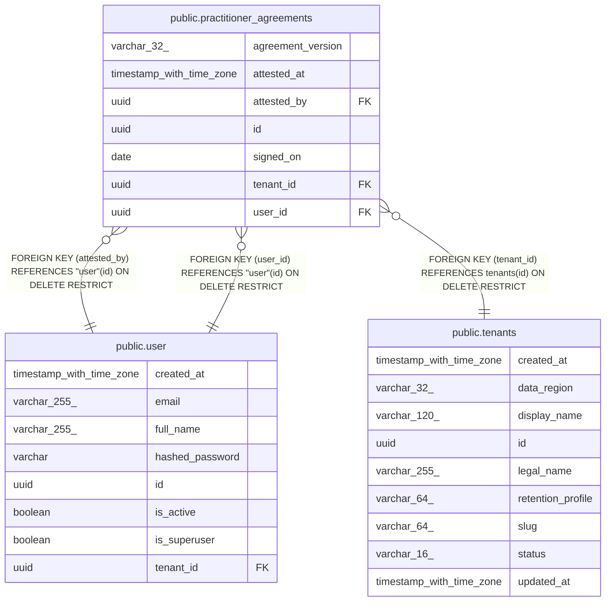

# public.practitioner_agreements

## Columns

| Name | Type | Default | Nullable | Children | Parents | Comment |
| ---- | ---- | ------- | -------- | -------- | ------- | ------- |
| agreement_version | varchar(32) |  | false |  |  |  |
| attested_at | timestamp with time zone |  | false |  |  |  |
| attested_by | uuid |  | false |  | [public.user](public.user.md) |  |
| id | uuid | gen_random_uuid() | false |  |  |  |
| signed_on | date |  | false |  |  |  |
| tenant_id | uuid |  | false |  | [public.tenants](public.tenants.md) |  |
| user_id | uuid |  | false |  | [public.user](public.user.md) |  |

## Constraints

| Name | Type | Definition |
| ---- | ---- | ---------- |
| fk_practitioner_agreements_attested_by_user | FOREIGN KEY | FOREIGN KEY (attested_by) REFERENCES "user"(id) ON DELETE RESTRICT |
| fk_practitioner_agreements_tenant_id_tenants | FOREIGN KEY | FOREIGN KEY (tenant_id) REFERENCES tenants(id) ON DELETE RESTRICT |
| fk_practitioner_agreements_user_id_user | FOREIGN KEY | FOREIGN KEY (user_id) REFERENCES "user"(id) ON DELETE RESTRICT |
| pk_practitioner_agreements | PRIMARY KEY | PRIMARY KEY (id) |
| practitioner_agreements_agreement_version_not_null | n | NOT NULL agreement_version |
| practitioner_agreements_attested_at_not_null | n | NOT NULL attested_at |
| practitioner_agreements_attested_by_not_null | n | NOT NULL attested_by |
| practitioner_agreements_id_not_null | n | NOT NULL id |
| practitioner_agreements_signed_on_not_null | n | NOT NULL signed_on |
| practitioner_agreements_tenant_id_not_null | n | NOT NULL tenant_id |
| practitioner_agreements_user_id_not_null | n | NOT NULL user_id |

## Indexes

| Name | Definition |
| ---- | ---------- |
| ix_practitioner_agreements_attested_by | CREATE INDEX ix_practitioner_agreements_attested_by ON public.practitioner_agreements USING btree (attested_by) |
| ix_practitioner_agreements_tenant_user | CREATE INDEX ix_practitioner_agreements_tenant_user ON public.practitioner_agreements USING btree (tenant_id, user_id) |
| ix_practitioner_agreements_user_id | CREATE INDEX ix_practitioner_agreements_user_id ON public.practitioner_agreements USING btree (user_id) |
| pk_practitioner_agreements | CREATE UNIQUE INDEX pk_practitioner_agreements ON public.practitioner_agreements USING btree (id) |

## Relations

---

> Generated by [tbls](https://github.com/k1LoW/tbls)
