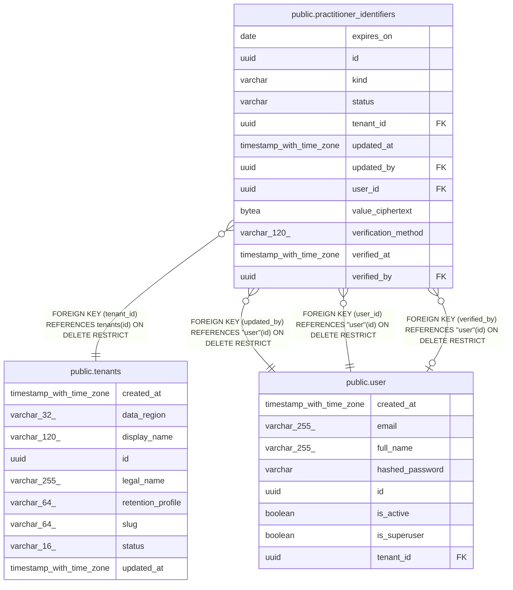

# public.practitioner_identifiers

## Columns

| Name | Type | Default | Nullable | Children | Parents | Comment |
| ---- | ---- | ------- | -------- | -------- | ------- | ------- |
| expires_on | date |  | true |  |  |  |
| id | uuid | gen_random_uuid() | false |  |  |  |
| kind | varchar |  | false |  |  |  |
| status | varchar |  | false |  |  |  |
| tenant_id | uuid |  | false |  | [public.tenants](public.tenants.md) |  |
| updated_at | timestamp with time zone |  | false |  |  |  |
| updated_by | uuid |  | false |  | [public.user](public.user.md) |  |
| user_id | uuid |  | false |  | [public.user](public.user.md) |  |
| value_ciphertext | bytea |  | false |  |  |  |
| verification_method | varchar(120) |  | true |  |  |  |
| verified_at | timestamp with time zone |  | true |  |  |  |
| verified_by | uuid |  | true |  | [public.user](public.user.md) |  |

## Constraints

| Name | Type | Definition |
| ---- | ---- | ---------- |
| ck_practitioner_identifiers_active_is_attested | CHECK | CHECK ((((status)::text = 'PENDING'::text) OR ((verified_by IS NOT NULL) AND (verified_at IS NOT NULL) AND (verification_method IS NOT NULL)))) |
| ck_practitioner_identifiers_kind | CHECK | CHECK (((kind)::text = ANY ((ARRAY['AHPRA'::character varying, 'HPI_I'::character varying, 'PRESCRIBER_NUMBER'::character varying, 'PROVIDER_NUMBER'::character varying])::text[]))) |
| ck_practitioner_identifiers_status | CHECK | CHECK (((status)::text = ANY ((ARRAY['PENDING'::character varying, 'ACTIVE'::character varying])::text[]))) |
| fk_practitioner_identifiers_tenant_id_tenants | FOREIGN KEY | FOREIGN KEY (tenant_id) REFERENCES tenants(id) ON DELETE RESTRICT |
| fk_practitioner_identifiers_updated_by_user | FOREIGN KEY | FOREIGN KEY (updated_by) REFERENCES "user"(id) ON DELETE RESTRICT |
| fk_practitioner_identifiers_user_id_user | FOREIGN KEY | FOREIGN KEY (user_id) REFERENCES "user"(id) ON DELETE RESTRICT |
| fk_practitioner_identifiers_verified_by_user | FOREIGN KEY | FOREIGN KEY (verified_by) REFERENCES "user"(id) ON DELETE RESTRICT |
| pk_practitioner_identifiers | PRIMARY KEY | PRIMARY KEY (id) |
| practitioner_identifiers_id_not_null | n | NOT NULL id |
| practitioner_identifiers_kind_not_null | n | NOT NULL kind |
| practitioner_identifiers_status_not_null | n | NOT NULL status |
| practitioner_identifiers_tenant_id_not_null | n | NOT NULL tenant_id |
| practitioner_identifiers_updated_at_not_null | n | NOT NULL updated_at |
| practitioner_identifiers_updated_by_not_null | n | NOT NULL updated_by |
| practitioner_identifiers_user_id_not_null | n | NOT NULL user_id |
| practitioner_identifiers_value_ciphertext_not_null | n | NOT NULL value_ciphertext |
| uq_practitioner_identifiers_tenant_user_kind | UNIQUE | UNIQUE (tenant_id, user_id, kind) |

## Indexes

| Name | Definition |
| ---- | ---------- |
| ix_practitioner_identifiers_updated_by | CREATE INDEX ix_practitioner_identifiers_updated_by ON public.practitioner_identifiers USING btree (updated_by) |
| ix_practitioner_identifiers_user_id | CREATE INDEX ix_practitioner_identifiers_user_id ON public.practitioner_identifiers USING btree (user_id) |
| ix_practitioner_identifiers_verified_by | CREATE INDEX ix_practitioner_identifiers_verified_by ON public.practitioner_identifiers USING btree (verified_by) |
| pk_practitioner_identifiers | CREATE UNIQUE INDEX pk_practitioner_identifiers ON public.practitioner_identifiers USING btree (id) |
| uq_practitioner_identifiers_tenant_user_kind | CREATE UNIQUE INDEX uq_practitioner_identifiers_tenant_user_kind ON public.practitioner_identifiers USING btree (tenant_id, user_id, kind) |

## Relations

---

> Generated by [tbls](https://github.com/k1LoW/tbls)
