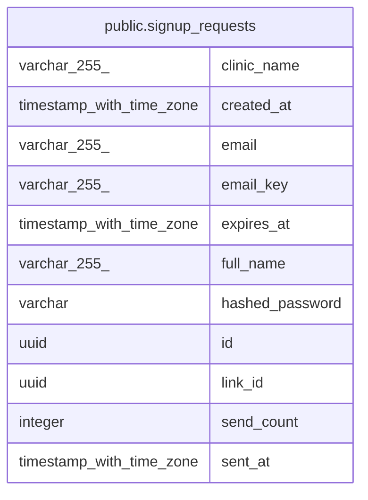

# public.signup_requests

## Columns

| Name | Type | Default | Nullable | Children | Parents | Comment |
| ---- | ---- | ------- | -------- | -------- | ------- | ------- |
| clinic_name | varchar(255) |  | true |  |  |  |
| created_at | timestamp with time zone |  | false |  |  |  |
| email | varchar(255) |  | false |  |  |  |
| email_key | varchar(255) |  | false |  |  |  |
| expires_at | timestamp with time zone |  | false |  |  |  |
| full_name | varchar(255) |  | true |  |  |  |
| hashed_password | varchar |  | true |  |  |  |
| id | uuid | gen_random_uuid() | false |  |  |  |
| link_id | uuid |  | false |  |  |  |
| send_count | integer |  | false |  |  |  |
| sent_at | timestamp with time zone |  | false |  |  |  |

## Constraints

| Name | Type | Definition |
| ---- | ---- | ---------- |
| ck_signup_requests_expiry_after_send | CHECK | CHECK ((expires_at > sent_at)) |
| ck_signup_requests_send_count_positive | CHECK | CHECK ((send_count >= 1)) |
| pk_signup_requests | PRIMARY KEY | PRIMARY KEY (id) |
| signup_requests_created_at_not_null | n | NOT NULL created_at |
| signup_requests_email_key_not_null | n | NOT NULL email_key |
| signup_requests_email_not_null | n | NOT NULL email |
| signup_requests_expires_at_not_null | n | NOT NULL expires_at |
| signup_requests_id_not_null | n | NOT NULL id |
| signup_requests_link_id_not_null | n | NOT NULL link_id |
| signup_requests_send_count_not_null | n | NOT NULL send_count |
| signup_requests_sent_at_not_null | n | NOT NULL sent_at |

## Indexes

| Name | Definition |
| ---- | ---------- |
| ix_signup_requests_email_key | CREATE INDEX ix_signup_requests_email_key ON public.signup_requests USING btree (email_key) |
| ix_signup_requests_expires_at | CREATE INDEX ix_signup_requests_expires_at ON public.signup_requests USING btree (expires_at) |
| pk_signup_requests | CREATE UNIQUE INDEX pk_signup_requests ON public.signup_requests USING btree (id) |

## Relations

---

> Generated by [tbls](https://github.com/k1LoW/tbls)
