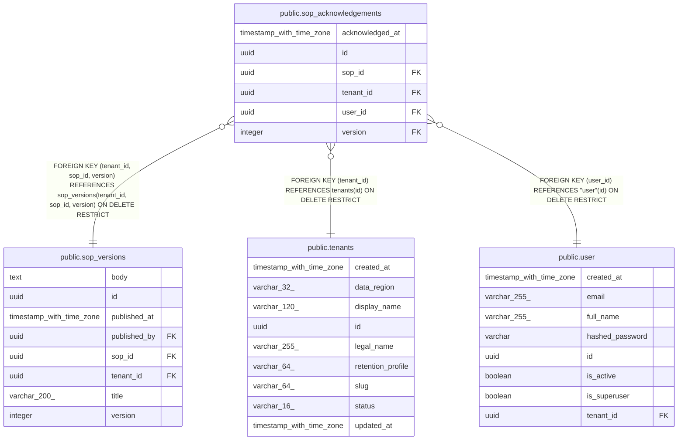

# public.sop_acknowledgements

## Columns

| Name | Type | Default | Nullable | Children | Parents | Comment |
| ---- | ---- | ------- | -------- | -------- | ------- | ------- |
| acknowledged_at | timestamp with time zone |  | false |  |  |  |
| id | uuid | gen_random_uuid() | false |  |  |  |
| sop_id | uuid |  | false |  | [public.sop_versions](public.sop_versions.md) |  |
| tenant_id | uuid |  | false |  | [public.tenants](public.tenants.md) [public.sop_versions](public.sop_versions.md) |  |
| user_id | uuid |  | false |  | [public.user](public.user.md) |  |
| version | integer |  | false |  | [public.sop_versions](public.sop_versions.md) |  |

## Constraints

| Name | Type | Definition |
| ---- | ---- | ---------- |
| fk_sop_acknowledgements_tenant_id_tenants | FOREIGN KEY | FOREIGN KEY (tenant_id) REFERENCES tenants(id) ON DELETE RESTRICT |
| fk_sop_acknowledgements_tenant_sop_version | FOREIGN KEY | FOREIGN KEY (tenant_id, sop_id, version) REFERENCES sop_versions(tenant_id, sop_id, version) ON DELETE RESTRICT |
| fk_sop_acknowledgements_user_id_user | FOREIGN KEY | FOREIGN KEY (user_id) REFERENCES "user"(id) ON DELETE RESTRICT |
| pk_sop_acknowledgements | PRIMARY KEY | PRIMARY KEY (id) |
| sop_acknowledgements_acknowledged_at_not_null | n | NOT NULL acknowledged_at |
| sop_acknowledgements_id_not_null | n | NOT NULL id |
| sop_acknowledgements_sop_id_not_null | n | NOT NULL sop_id |
| sop_acknowledgements_tenant_id_not_null | n | NOT NULL tenant_id |
| sop_acknowledgements_user_id_not_null | n | NOT NULL user_id |
| sop_acknowledgements_version_not_null | n | NOT NULL version |
| uq_sop_acknowledgements_tenant_sop_version_user | UNIQUE | UNIQUE (tenant_id, sop_id, version, user_id) |

## Indexes

| Name | Definition |
| ---- | ---------- |
| ix_sop_acknowledgements_tenant_user | CREATE INDEX ix_sop_acknowledgements_tenant_user ON public.sop_acknowledgements USING btree (tenant_id, user_id) |
| pk_sop_acknowledgements | CREATE UNIQUE INDEX pk_sop_acknowledgements ON public.sop_acknowledgements USING btree (id) |
| uq_sop_acknowledgements_tenant_sop_version_user | CREATE UNIQUE INDEX uq_sop_acknowledgements_tenant_sop_version_user ON public.sop_acknowledgements USING btree (tenant_id, sop_id, version, user_id) |

## Relations

---

> Generated by [tbls](https://github.com/k1LoW/tbls)
