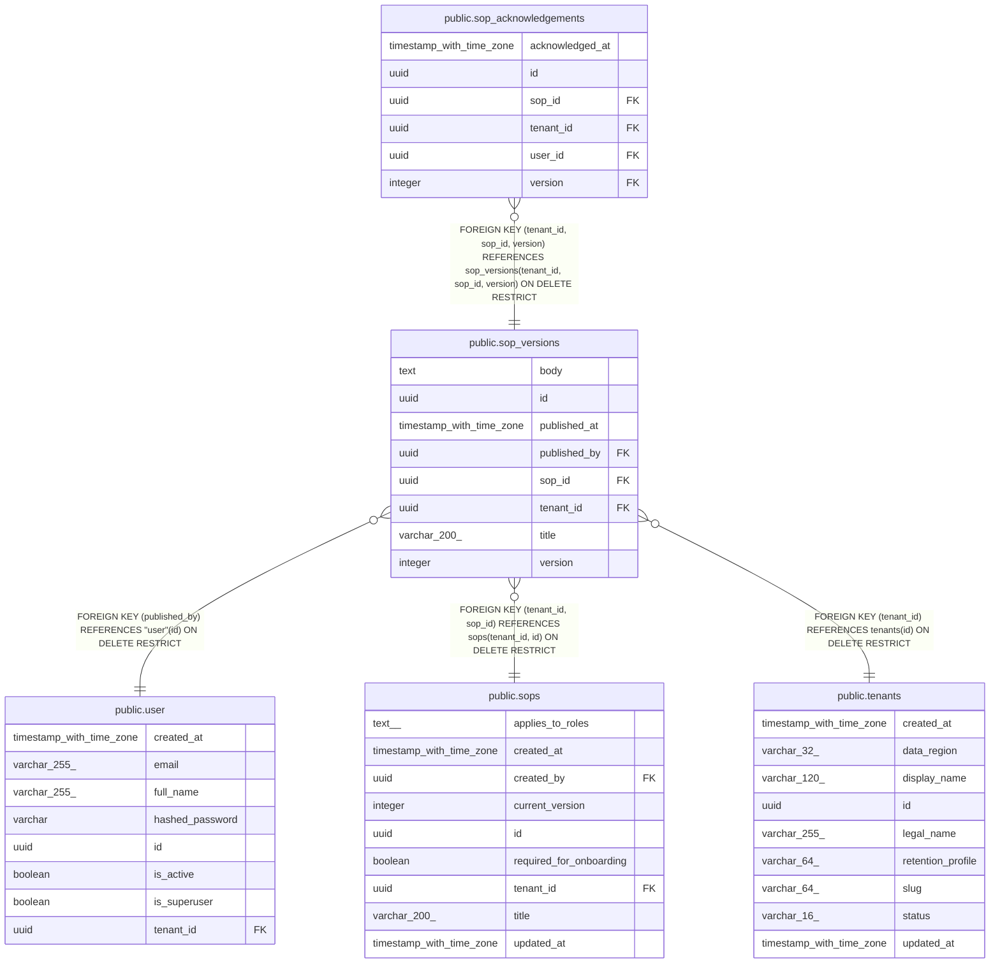

# public.sop_versions

## Columns

| Name | Type | Default | Nullable | Children | Parents | Comment |
| ---- | ---- | ------- | -------- | -------- | ------- | ------- |
| body | text |  | false |  |  |  |
| id | uuid | gen_random_uuid() | false |  |  |  |
| published_at | timestamp with time zone |  | false |  |  |  |
| published_by | uuid |  | false |  | [public.user](public.user.md) |  |
| sop_id | uuid |  | false | [public.sop_acknowledgements](public.sop_acknowledgements.md) | [public.sops](public.sops.md) |  |
| tenant_id | uuid |  | false | [public.sop_acknowledgements](public.sop_acknowledgements.md) | [public.tenants](public.tenants.md) [public.sops](public.sops.md) |  |
| title | varchar(200) |  | false |  |  |  |
| version | integer |  | false | [public.sop_acknowledgements](public.sop_acknowledgements.md) |  |  |

## Constraints

| Name | Type | Definition |
| ---- | ---- | ---------- |
| ck_sop_versions_version | CHECK | CHECK ((version >= 1)) |
| fk_sop_versions_published_by_user | FOREIGN KEY | FOREIGN KEY (published_by) REFERENCES "user"(id) ON DELETE RESTRICT |
| fk_sop_versions_tenant_id_tenants | FOREIGN KEY | FOREIGN KEY (tenant_id) REFERENCES tenants(id) ON DELETE RESTRICT |
| fk_sop_versions_tenant_sop | FOREIGN KEY | FOREIGN KEY (tenant_id, sop_id) REFERENCES sops(tenant_id, id) ON DELETE RESTRICT |
| pk_sop_versions | PRIMARY KEY | PRIMARY KEY (id) |
| sop_versions_body_not_null | n | NOT NULL body |
| sop_versions_id_not_null | n | NOT NULL id |
| sop_versions_published_at_not_null | n | NOT NULL published_at |
| sop_versions_published_by_not_null | n | NOT NULL published_by |
| sop_versions_sop_id_not_null | n | NOT NULL sop_id |
| sop_versions_tenant_id_not_null | n | NOT NULL tenant_id |
| sop_versions_title_not_null | n | NOT NULL title |
| sop_versions_version_not_null | n | NOT NULL version |
| uq_sop_versions_tenant_sop_version | UNIQUE | UNIQUE (tenant_id, sop_id, version) |

## Indexes

| Name | Definition |
| ---- | ---------- |
| ix_sop_versions_published_by | CREATE INDEX ix_sop_versions_published_by ON public.sop_versions USING btree (published_by) |
| pk_sop_versions | CREATE UNIQUE INDEX pk_sop_versions ON public.sop_versions USING btree (id) |
| uq_sop_versions_tenant_sop_version | CREATE UNIQUE INDEX uq_sop_versions_tenant_sop_version ON public.sop_versions USING btree (tenant_id, sop_id, version) |

## Relations

---

> Generated by [tbls](https://github.com/k1LoW/tbls)
