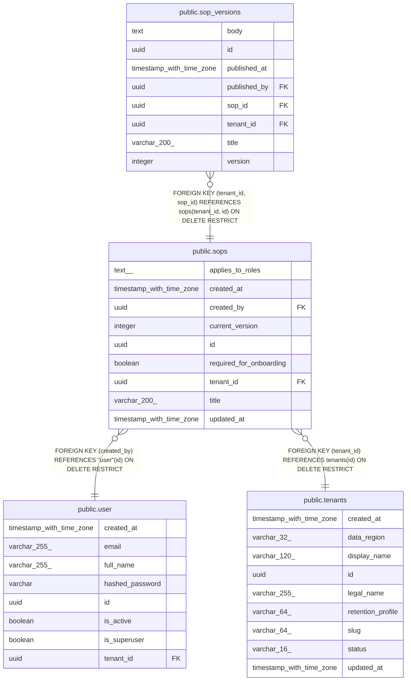

# public.sops

## Columns

| Name | Type | Default | Nullable | Children | Parents | Comment |
| ---- | ---- | ------- | -------- | -------- | ------- | ------- |
| applies_to_roles | text[] | '{}'::text[] | false |  |  |  |
| created_at | timestamp with time zone |  | false |  |  |  |
| created_by | uuid |  | false |  | [public.user](public.user.md) |  |
| current_version | integer |  | false |  |  |  |
| id | uuid | gen_random_uuid() | false | [public.sop_versions](public.sop_versions.md) |  |  |
| required_for_onboarding | boolean | false | false |  |  |  |
| tenant_id | uuid |  | false | [public.sop_versions](public.sop_versions.md) | [public.tenants](public.tenants.md) |  |
| title | varchar(200) |  | false |  |  |  |
| updated_at | timestamp with time zone |  | false |  |  |  |

## Constraints

| Name | Type | Definition |
| ---- | ---- | ---------- |
| ck_sops_current_version | CHECK | CHECK ((current_version >= 1)) |
| fk_sops_created_by_user | FOREIGN KEY | FOREIGN KEY (created_by) REFERENCES "user"(id) ON DELETE RESTRICT |
| fk_sops_tenant_id_tenants | FOREIGN KEY | FOREIGN KEY (tenant_id) REFERENCES tenants(id) ON DELETE RESTRICT |
| pk_sops | PRIMARY KEY | PRIMARY KEY (id) |
| sops_applies_to_roles_not_null | n | NOT NULL applies_to_roles |
| sops_created_at_not_null | n | NOT NULL created_at |
| sops_created_by_not_null | n | NOT NULL created_by |
| sops_current_version_not_null | n | NOT NULL current_version |
| sops_id_not_null | n | NOT NULL id |
| sops_required_for_onboarding_not_null | n | NOT NULL required_for_onboarding |
| sops_tenant_id_not_null | n | NOT NULL tenant_id |
| sops_title_not_null | n | NOT NULL title |
| sops_updated_at_not_null | n | NOT NULL updated_at |
| uq_sops_tenant_id_id | UNIQUE | UNIQUE (tenant_id, id) |

## Indexes

| Name | Definition |
| ---- | ---------- |
| ix_sops_created_by | CREATE INDEX ix_sops_created_by ON public.sops USING btree (created_by) |
| pk_sops | CREATE UNIQUE INDEX pk_sops ON public.sops USING btree (id) |
| uq_sops_tenant_id_id | CREATE UNIQUE INDEX uq_sops_tenant_id_id ON public.sops USING btree (tenant_id, id) |

## Relations

---

> Generated by [tbls](https://github.com/k1LoW/tbls)
