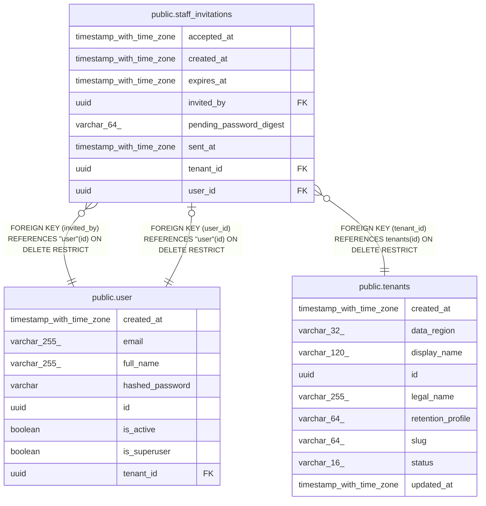

# public.staff_invitations

## Columns

| Name | Type | Default | Nullable | Children | Parents | Comment |
| ---- | ---- | ------- | -------- | -------- | ------- | ------- |
| accepted_at | timestamp with time zone |  | true |  |  |  |
| created_at | timestamp with time zone |  | false |  |  |  |
| expires_at | timestamp with time zone |  | false |  |  |  |
| invited_by | uuid |  | false |  | [public.user](public.user.md) |  |
| pending_password_digest | varchar(64) |  | false |  |  |  |
| sent_at | timestamp with time zone |  | false |  |  |  |
| tenant_id | uuid |  | false |  | [public.tenants](public.tenants.md) |  |
| user_id | uuid |  | false |  | [public.user](public.user.md) |  |

## Constraints

| Name | Type | Definition |
| ---- | ---- | ---------- |
| ck_staff_invitations_expiry_after_send | CHECK | CHECK ((expires_at > sent_at)) |
| fk_staff_invitations_invited_by_user | FOREIGN KEY | FOREIGN KEY (invited_by) REFERENCES "user"(id) ON DELETE RESTRICT |
| fk_staff_invitations_tenant_id_tenants | FOREIGN KEY | FOREIGN KEY (tenant_id) REFERENCES tenants(id) ON DELETE RESTRICT |
| fk_staff_invitations_user_id_user | FOREIGN KEY | FOREIGN KEY (user_id) REFERENCES "user"(id) ON DELETE RESTRICT |
| pk_staff_invitations | PRIMARY KEY | PRIMARY KEY (user_id) |
| staff_invitations_created_at_not_null | n | NOT NULL created_at |
| staff_invitations_expires_at_not_null | n | NOT NULL expires_at |
| staff_invitations_invited_by_not_null | n | NOT NULL invited_by |
| staff_invitations_pending_password_digest_not_null | n | NOT NULL pending_password_digest |
| staff_invitations_sent_at_not_null | n | NOT NULL sent_at |
| staff_invitations_tenant_id_not_null | n | NOT NULL tenant_id |
| staff_invitations_user_id_not_null | n | NOT NULL user_id |

## Indexes

| Name | Definition |
| ---- | ---------- |
| ix_staff_invitations_tenant_id | CREATE INDEX ix_staff_invitations_tenant_id ON public.staff_invitations USING btree (tenant_id) |
| pk_staff_invitations | CREATE UNIQUE INDEX pk_staff_invitations ON public.staff_invitations USING btree (user_id) |

## Relations

---

> Generated by [tbls](https://github.com/k1LoW/tbls)
