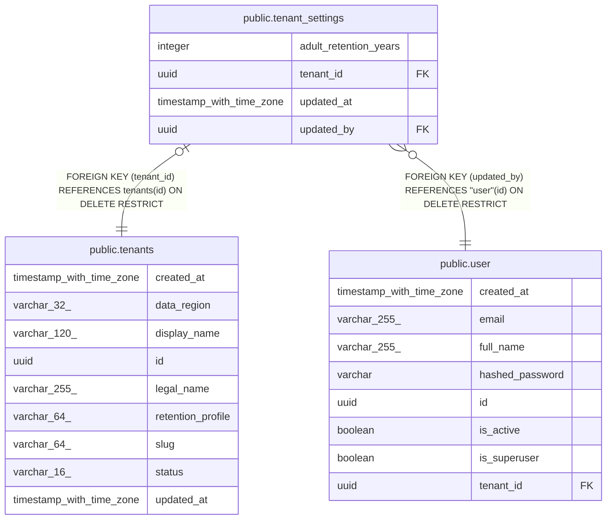

# public.tenant_settings

## Columns

| Name | Type | Default | Nullable | Children | Parents | Comment |
| ---- | ---- | ------- | -------- | -------- | ------- | ------- |
| adult_retention_years | integer |  | false |  |  |  |
| tenant_id | uuid |  | false |  | [public.tenants](public.tenants.md) |  |
| updated_at | timestamp with time zone |  | false |  |  |  |
| updated_by | uuid |  | false |  | [public.user](public.user.md) |  |

## Constraints

| Name | Type | Definition |
| ---- | ---- | ---------- |
| ck_tenant_settings_adult_retention_years | CHECK | CHECK ((adult_retention_years >= 7)) |
| fk_tenant_settings_tenant_id_tenants | FOREIGN KEY | FOREIGN KEY (tenant_id) REFERENCES tenants(id) ON DELETE RESTRICT |
| fk_tenant_settings_updated_by_user | FOREIGN KEY | FOREIGN KEY (updated_by) REFERENCES "user"(id) ON DELETE RESTRICT |
| pk_tenant_settings | PRIMARY KEY | PRIMARY KEY (tenant_id) |
| tenant_settings_adult_retention_years_not_null | n | NOT NULL adult_retention_years |
| tenant_settings_tenant_id_not_null | n | NOT NULL tenant_id |
| tenant_settings_updated_at_not_null | n | NOT NULL updated_at |
| tenant_settings_updated_by_not_null | n | NOT NULL updated_by |

## Indexes

| Name | Definition |
| ---- | ---------- |
| ix_tenant_settings_updated_by | CREATE INDEX ix_tenant_settings_updated_by ON public.tenant_settings USING btree (updated_by) |
| pk_tenant_settings | CREATE UNIQUE INDEX pk_tenant_settings ON public.tenant_settings USING btree (tenant_id) |

## Relations

---

> Generated by [tbls](https://github.com/k1LoW/tbls)
