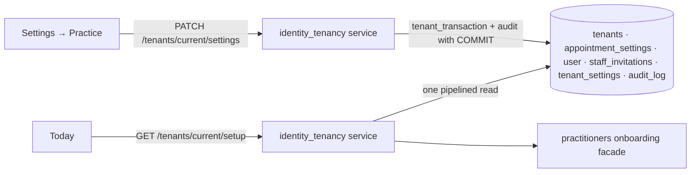

# Clinic setup: design

## Screens

### Today → setup checklist card

Top of `/` (Today), above the KPI cards, for `tenant:configure` holders only. Serif title "Set up your
clinic", a thin progress bar, then one row per step: status dot (done / to do / optional /
informational), one-line description, and an action link ("Set hours →"). Collapse chevron top-right;
the collapsed state is a per-browser convenience in `localStorage` (try/catch, renders correctly
without it).

### Settings → Practice (new tab)

Next to the existing Clinic tab (`frontend/src/features/settings/`). Two cards:

- **Practice workflow** — radio group "Who may stage script drafts": Nurses · Nurses and doctors ·
  Nurses, doctors and reception. A note under the reception option: "Reception can suggest a product
  only as a note."
- **Record retention** — number input "Adult records (years)", minimum 7; read-only line "Records of
  minors: kept until the patient turns 25".

Both save with one button; read-only with an explanation for anyone without `tenant:configure`.

## States

Checklist: skeleton rows while loading; hidden (not an error) on `403`; a retry row on failure. Settings:
loading, saved toast, field errors inline, `403` read-only view.

## Data model

**No table for progress.** `GET /tenants/current/setup` computes each step from data that already
exists, so the checklist can never disagree with reality:

| Step | Computed from |
|---|---|
| Clinic name | `tenants.display_name IS NOT NULL` |
| Hours | `appointment_settings` row for the tenant |
| Permission grid reviewed | an `audit_log` event `role.list_viewed` by a `tenant:configure` holder (new event; read audit only) |
| Team invited | `count(user) > 1` in the tenant, or a `staff_invitations` row |
| Prescriber ready | feature 02 `GET /practitioners/{id}/onboarding` is complete for ≥ 1 prescriber |
| Workflow saved | `tenant_settings.updated_at IS NOT NULL` |
| Consents published | feature 03: each required `consent_documents.kind` has a published version |

**Settings** need a home (decision table "Schema changes"): `tenant_settings(tenant_id PK/FK,
draft_staging_roles text[], adult_retention_years int CHECK (>= 7), updated_at, updated_by)`, forced
RLS. One row per tenant, created on first save; a missing row means the defaults (Nurse only, 7 years)
— and "Workflow saved" stays undone, fail closed.

## Data flow

The setup read is one flight (`run_pipelined`), so it adds one round trip to Today, not seven.

## Where the code goes

`backend/app/modules/identity_tenancy/` (settings, setup read) — it already owns `tenants`.
`frontend/src/features/today/SetupChecklist.tsx`, `frontend/src/features/settings/PracticeTab.tsx`.
