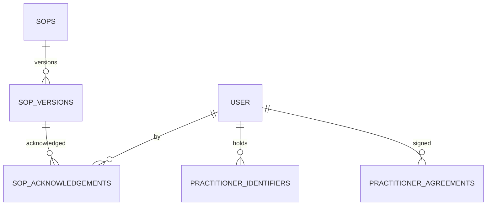
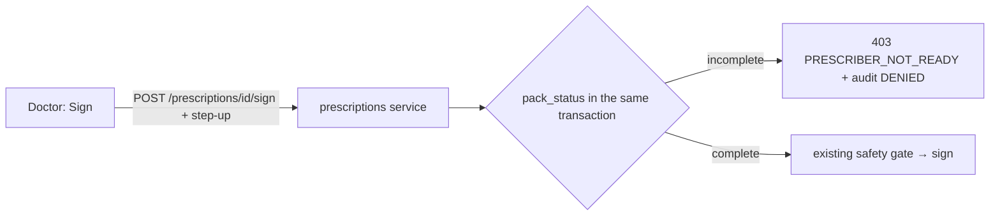

# Staff onboarding: design

## Screens

### Admin → Staff (existing `StaffPanel.tsx`)

Adds an **Onboarding** column (status pill) and, for prescribers, a row action **Onboarding pack**.

### Onboarding pack (dialog from a prescriber row)

Header: name, roles, pack status. Three sections, each with a tick or a list of what's missing:

1. **Agreement** — "Signed version 2025-1 on 3 Oct 2026 · attested by Sam Lee" or *Record agreement*.
2. **Identifiers** — one row per identifier: masked value (`MED•••••••123`), status pill, expiry, "Verified
   by … on …". *Edit* opens a step-up prompt, then a form with format hints.
3. **SOPs** — each required SOP: title, current version, acknowledged ✓ / not yet.

### Today → "Your first hour" card

Role-specific checklist from the manual's quick-starts, showing only lines whose screen exists today:

| Role | Lines (Phase 5) |
|---|---|
| Reception / Admin | Open Today · Patients → Online applications (feature 03) · Press `/` to find a patient · + New patient |
| Nurse | Open Script queue · Stage a draft with triage outcome · Check the approval chip |
| Doctor | Today · Script queue → Review & sign · Your onboarding pack status |
| Practice manager | Permission grid · Invite staff · Onboarding packs · Settings → Practice (feature 01) |

### SOPs (new page, Practice section)

List with version, roles, required flag and *your* acknowledgement; a reader with **Acknowledge
version N** at the foot; an editor for `tenant:configure`; the matrix as a tab. Print view adds the
UNCONTROLLED COPY watermark.

## States

Every screen: loading, empty ("No SOPs yet — publish your first"), error with retry, `403` explanation.
The pack dialog shows a refusal panel if step-up is cancelled or fails.

## Data model

All tenant-scoped, forced RLS, no `DELETE` grant to `clinos_app`:

| Table | Key columns |
|---|---|
| `practitioner_identifiers` | `user_id`, `kind` (`AHPRA`, `HPI_I`, `PRESCRIBER_NUMBER`, `PROVIDER_NUMBER`, `ERX_ID`), `value_ciphertext`, `value_last3`, `location_clinic_id` (provider number only), `status`, `expires_on`, `verified_by`, `verified_at`, `verification_method`. Unique `(tenant_id, user_id, kind, location_clinic_id)` |
| `practitioner_agreements` | `user_id`, `agreement_version`, `signed_on`, `attested_by`, `attested_at` |
| `sops` | `title`, `applies_to_roles text[]`, `required_for_onboarding bool`, `current_version` |
| `sop_versions` | `sop_id`, `version`, `body`, `published_by`, `published_at`. Append-only |
| `sop_acknowledgements` | `sop_version_id`, `user_id`, `acknowledged_at`. Unique `(sop_version_id, user_id)`. Append-only |

Identifier values are encrypted with the same envelope as patient identifiers (feature 04, D13); only
the last three characters are stored in clear for display.

**Pack status is derived** (`users_roles.onboarding.pack_status(user_id)`), never stored: the three
ticks are queries. The sign gate calls the same function, so the dialog and the gate can't disagree.

## Data flow: the signing gate

## Where the code goes

`backend/app/modules/users_roles/` owns identifiers, agreements and pack status (it owns roles).
A new `backend/app/modules/sops/` owns SOPs. `prescriptions` reaches pack status only through the
`users_roles` service facade.
