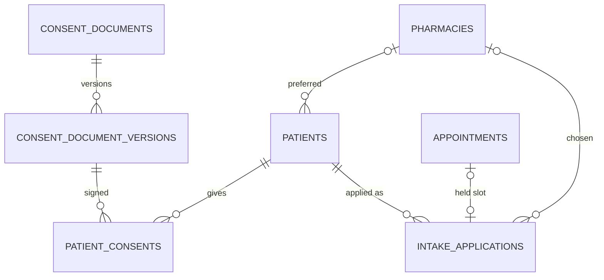
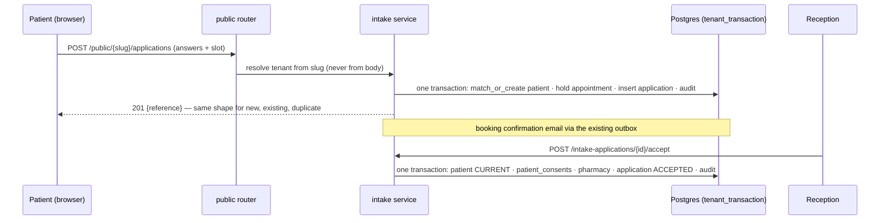

# Patient intake: design

## Screens

### Public: `/book/<clinic-slug>` (rebuilt `features/booking/BookingPage.tsx`)

Clinic display name and a plain-English header. A six-dot stepper; one step per screen; large touch
targets (≥ 44 px); Back and Continue at the foot. After step 6, the existing visit-type and slot picker,
then the confirmation with the booking reference. Under-18 replaces the form with a closing message.
If the clinic has no published consents, the page says "Online applications are not open yet".

### Staff: Patients → Online applications (new tab on `/patients`)

Queue of cards: name, age, submitted (relative), held appointment, flag chips (safety answers,
under-treatment history), and **Matched existing patient** when the duplicate check found one. Opening
a card shows the answers by step, the consents with versions, the pharmacy choice, the declaration and
**Accept** / **Reject**. Reject opens a reason dialog. A count badge on the Patients nav item.

### Patient record → Overview

An **Intake briefing** card (for permitted clinicians) and a **Consents** card listing kind, version,
signed date, and a re-consent chip when outdated.

### Settings → Consents (new tab)

Per kind: current version, published date, *Publish new version* (textarea + "material change?"
toggle, which drives re-consent flags).

## States

Public: field errors inline; network failure keeps answers and retries; slot taken → "That time
isn't available" (existing `SLOT_NOT_OFFERED`). Queue: empty ("No new applications"), loading, error,
`403`, and a `409` toast if someone else decided the application first.

## Data model

| Table | Key columns |
|---|---|
| `intake_applications` | `patient_id`, `appointment_id` (nullable), `status` (`SUBMITTED`, `ACCEPTED`, `REJECTED`), `answers jsonb` (steps 2–3, schema-versioned), `flags text[]`, `submitted_sex`, `submitted_address_*`, `pharmacy_id` or `own_pharmacy jsonb`, `declaration_name`, `declared_at`, `consent_version_ids uuid[]`, `decided_by`, `decided_at`, `decision_reason_code`, `decision_note`. Classification: **HIGHLY_SENSITIVE** (`answers`) |
| `consent_documents` | `kind`, `current_version` |
| `consent_document_versions` | `consent_document_id`, `version`, `body`, `material_change`, `published_by`, `published_at`. Append-only |
| `patient_consents` | `patient_id`, `consent_document_version_id`, `method`, `signed_at`, `recorded_by` (null for online). Append-only |
| `pharmacies` | `name`, `suburb`, `address`, `email`, `phone`, `provider_number`, `is_partner`, `created_from` (`ADMIN`, `APPLICATION`) |

The briefing note is **derived from `intake_applications.answers`** at read time, not a clinical
record — a clinical note must have a human author (identity-bound, manual §1.4).

## Data flow

## Where the code goes

A new module `backend/app/modules/intake/` owns `intake_applications`, `consent_*` and the queue; a new
`backend/app/modules/pharmacies/` owns `pharmacies`. Both reach patients and appointments only through
their service facades. The public route mounts beside the existing `public_router`.
