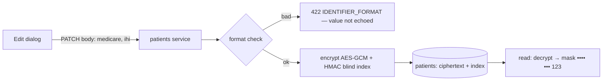

# Patient record: design

## Screens

### Patient record header (`/patients/$id`)

Name · reference · DOB (age) · sex, then a **status pill** (same colour everywhere), **alert chips**
(tone-coloured), the **⚡ eScript-ready** chip or "Not eScript-ready: IHI, address", and actions:
*Edit details*, *Change status*, *Add alert*.

### Overview tab

Adds cards: **Identifiers** (Medicare and IHI masked, "format checked" badge), **Emergency contacts**,
**Communications** (receives communications on/off, timezone), **Pharmacy** (with *Change pharmacy*).

### Add / edit dialog

Adds sex (required), the one-line address with split preview, Medicare + IRN, IHI, receives
communications (ticked), timezone. Errors inline. The same dialog creates and edits (manual Fig 6).

### Patients list

Status filter pill (default: active statuses); status column.

## States

As today, plus: change-status dialog with required reason; `422 IDENTIFIER_FORMAT` inline; a `BLOCKED`
refusal panel on the calendar and script staging that names the block.

## Data model

| Change | Detail |
|---|---|
| `patients.status` | `text NOT NULL DEFAULT 'CURRENT'`, check constraint `ck_patients_status`; `status_reason text`, `status_changed_at`, `status_changed_by` |
| `patients.receives_communications` | `bool NOT NULL DEFAULT true` |
| `patients.timezone` | `text NOT NULL DEFAULT 'Australia/Sydney'` (IANA, validated) |
| `patients.preferred_pharmacy_id` | FK `pharmacies(tenant_id, id)` (03) |
| `patients.medicare_irn` | `smallint` 1–9 |
| `patients.medicare_number`, `ihi` (+ blind indexes) | **Already exist, unused** — now written: AES-GCM envelope (`key_version` prefix), HMAC-SHA256 blind index (D13) |
| `patient_alerts` | `patient_id`, `text`, `tone`, `created_by`, `created_at`, `removed_at`, `removed_by` (soft remove) |
| `patient_emergency_contacts` | `patient_id`, `name`, `relationship`, `phone`, `created_at`, `removed_at` |

Migration backfill: every existing patient → `CURRENT` (or `DECEASED` where `deceased_at` is set).

## Data flow: identifiers

Plaintext identifiers exist only in request memory: never logged, never in errors, never in audit
payloads (INV-5).

## Where the code goes

All inside `backend/app/modules/patients/` (it owns `patients`). The encryption helper goes in
`backend/app/core/` so feature 02's vault reuses it.
